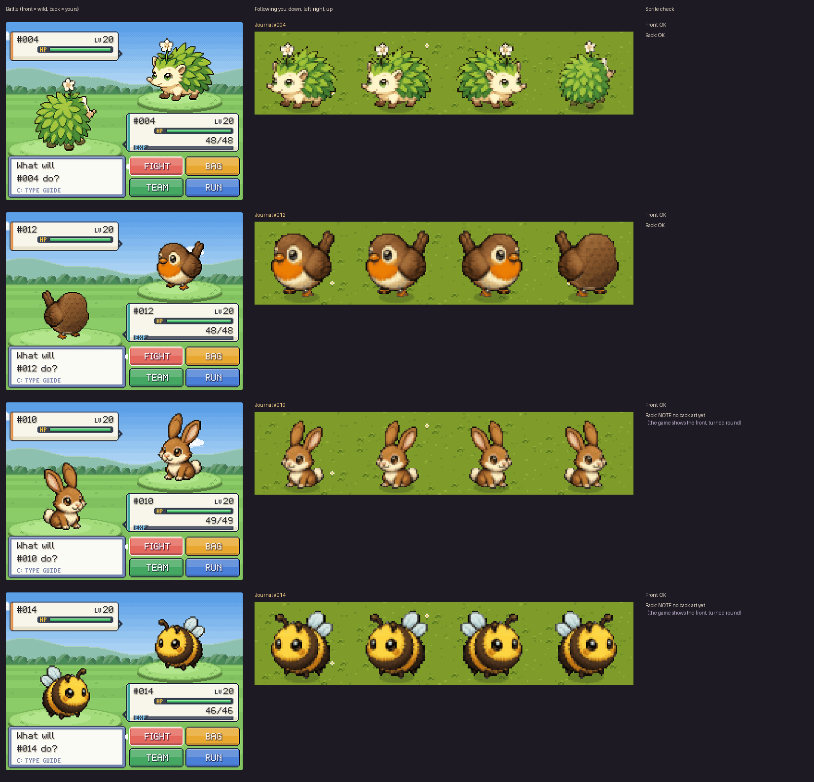

# Sprite workshop

Tools for making, checking and previewing Brackenshire's art. Everything runs from the repo's top folder.

## Setup (once)
    pip install -r tools/requirements.txt

## Everyday loop
1. **Get the sprites as image files.** `python3 tools/unpack_assets.py` writes every sprite stored in
   `src/36_assets.js` to `art/out/<name>.png` (`b_<id>_f.png` front, `b_<id>_b.png` back).
2. **Add or edit sprites** in `art/out/` (by hand, from SpriteCook or Retro Diffusion, or painted with `tools/inhouse/`).
3. **Check them.** `python3 tools/check_sprites.py` (or name some Beasties) lists anything off-style in plain words:
   half-see-through edges, wrong size, too many colours, patchy or pure-black outline, light from the wrong side,
   baked-in ground shadow, and how many Beasties still have no back view.
4. **Pack them back.** `python3 tools/build_assets.py` then `python3 build.py`. Sprites you did not touch keep
   their exact bytes, so the change only shows what you edited.
5. **Look at them in the game.** `python3 tools/preview.py <ids>` or `--random 3` saves `shots/preview.png`:
   a real battle (front as the wild Beastie, back as yours), the follower walking down, left, right and up on
   grass, and the checker's verdict. Rows are labelled by Journal number, not name.

## The older tools
`tools/slice.py`, `beasts20.py`, `rd_slice.py`, `rd_enhance.py`, `tools/inhouse/` and `test/*.py` were copied
unchanged from the code kept in `docs/brackenshire-art-tools.md` and `docs/brackenshire-inhouse-sprites.md`.
Some expect the raw template images under `art/tpl/` or `art/rd/`, which are not in the repo yet.
